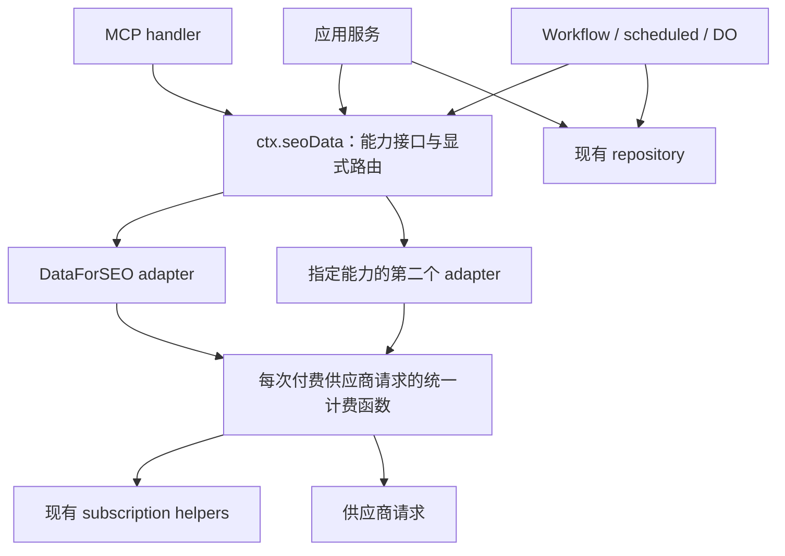

# Cordis 数据能力插件接入与维护评审

状态：历史评审基线与分阶段提案。评审日期：2026-09-07。后续已实现装配校验、缺依赖审计、失败清理，以及 `seoData` / `dataforseo` 插件。关键词指标与实时 SERP 已采用应用自有 Zod schema 和显式 provider 路由，其余接口保留供应商专用协议。下述问题与探针记录描述评审时的源码；当前行为见 [PLUGINS.md](./PLUGINS.md)，已落实的契约及后续来源追踪要求见 [SEO data contract](../src/plugins/seo-data/README.md)。

源码基线：orca `973f4200e5b02dcb3068e0486e13a1d9da3fd29d`；deepseek-harness `d347e703908d0406b7a7ef80e3a0e594d86b2215`。本文区分已验证的现状与建议方案，不改变既有业务策略。任何新增或修改的 fallback 均须在改代码前取得维护者同意。

## 结论

沿用仓库已有的 Cordis、loader 和静态 manifest，落地 `ctx.seoData`。按可独立替换的数据能力注册 provider，调用方依赖应用自己的输入输出类型。建议从 `keywordMetrics` 开始，接着评估实时 SERP；每迁移一个能力，都覆盖它的应用、MCP 和后台调用方。

先证明一个能力可以完整替换，再扩展其他能力。计费服务商替换、MCP 工具插件化、在线插件安装和插件管理 UI 可以独立排期，不应成为数据源替换的前置条件。

## 仓库现状与评审发现

### 已有基础可以复用

[`package.json`](../package.json) 已精确固定 `cordis@4.0.0-rc.8`，并链接本地 loader。当前 [`manifest.yaml`](../src/plugins/manifest.yaml) 只有客户端 locale 插件，`server: []`；[`module-map.ts`](../src/plugins/module-map.ts) 的 `serverModules` 也为空。服务端 [`getAppContext()`](../src/plugins/server/context.ts) 已在 HTTP 入口启动。

[`PLUGINS.md`](./PLUGINS.md) 已提出 `billing`、`seoData`、`mcp`，但明确标为尚未实现的设计。这里需要推进现有设计，并修订“endpoint-family 接口”“Google connectors 成为第二 adapter”等过于宽泛的部分。

### 接入业务插件前应修复的基础问题

| 优先级             | 已验证的问题                                                                                                                               | 接入后的影响                                                         | 建议处理                                                                                                                 |
| ------------------ | ------------------------------------------------------------------------------------------------------------------------------------------ | -------------------------------------------------------------------- | ------------------------------------------------------------------------------------------------------------------------ |
| P1，业务插件接入前 | [`bootPlugins()`](../src/plugins/shared/plugin.ts) 等待 loader 后，没有审计仍为 PENDING 的必需插件。缺少 `inject` 依赖时启动仍成功         | 服务树看似就绪，实际缺少所选数据能力或计费依赖                       | loader 收敛后检查启用条目和已配置能力；报告 entry ID、未满足依赖、缺失 provider。禁用条目不参与要求                      |
| P2                 | [`manifest.ts`](../src/plugins/shared/manifest.ts) 使用普通 `z.object`，与注释中的“未知字段拒绝”不符。`inject`、拼错的 `disabeld` 会被丢弃 | 配置不按作者意图执行，尤其可能错误启用插件                           | 外层和条目使用严格 schema；配置由插件自己的 `Config` 验证。模块级 `inject` 已足够，第一阶段无需开放 manifest 的 `inject` |
| P2                 | manifest 没有唯一 ID 校验，boot 逐条 `loader.create`，绕过了 group 批量更新的重复 ID 检查                                                  | 同 ID 的第二个条目替换第一个，树里只有一个 entry，配置列表却留下两行 | 在启动任何插件前拒绝同侧重复 ID 和空 ID/name                                                                             |
| P2，生命周期完整性 | 第二个条目启动失败时，已启动的第一个条目仍保留；[`getAppContext()`](../src/plugins/server/context.ts) 只清空 memo，没有释放失败的 Context  | 后续重试可能遗留旧注册或外部资源；当前空 server 树尚未承载这些资源   | Context 创建者负责失败清理，await 根 fiber 的 dispose；保留原始失败信息，并让并发请求共享同一次启动结果                  |

不要把“服务注册完成”与“供应商联网成功”混为一谈。启动审计验证插件和能力配置，不在全站启动路径执行付费请求或远程健康检查。数据源凭证及远端错误应在对应调用中处理。

### 数据源耦合已经超出 HTTP client

[`createDataforseoClient()`](../src/server/lib/dataforseo/client.ts) 是可以复用的付费调用入口：按请求接收组织身份，延迟加载 SDK，调用前检查 credits，调用后记录成本。以下行为仍与 DataForSEO 紧密关联：

| 位置                                                                                                                                                                                                                                                                               | 耦合                                                                                       | 替换时需要保留的含义                                             |
| ---------------------------------------------------------------------------------------------------------------------------------------------------------------------------------------------------------------------------------------------------------------------------------- | ------------------------------------------------------------------------------------------ | ---------------------------------------------------------------- |
| [`keyword-metrics.ts`](../src/server/lib/dataforseo/keyword-metrics.ts)                                                                                                                                                                                                            | Labs / Google Ads 地区分流、700 条分批、当地 volume 与全国 KD/intent 合并                  | 数值的来源、地理范围、缺失状态，以及一次能力调用可能产生多次收费 |
| [`research-data.ts`](../src/plugins/keywords/server/services/research/research-data.ts)、[`domainKeywordFilters.ts`](../src/server/features/domain/services/domainKeywordFilters.ts)、[`backlinksApiFilters.ts`](../src/server/features/backlinks/services/backlinksApiFilters.ts) | 业务代码读取 SDK 字段、拼接 DataForSEO filter 表达式                                       | 新 provider 不应被迫伪造 DataForSEO 的对象或过滤语法             |
| [`client.ts`](../src/server/lib/dataforseo/client.ts)、[`envelope.ts`](../src/server/lib/dataforseo/envelope.ts)                                                                                                                                                                   | 成本来自 task.path/cost，失败依赖 `DataforseoChargedTaskError`，feature 可由 endpoint 推导 | 已收费失败、免费读取、组织归属和每笔取整不能丢失                 |
| [`research.ts`](../src/plugins/keywords/server/services/research/research.ts)、[`serp.ts`](../src/plugins/keywords/server/services/research/serp.ts)                                                                                                                               | 缓存按业务输入生成，没有显式 provider/dataset 标识                                         | 切换后不得将旧来源缓存误当成新来源结果                           |
| [`keywordMetrics` / `rankTrackingKeywords`](../src/db/app.schema.ts)                                                                                                                                                                                                               | 存有最近指标和时间，没有供应商及指标来源记录                                               | 历史数据与新来源数据的比较必须可以解释                           |
| [`rankCheckPaths.ts`](../src/server/workflows/rankCheckPaths.ts)、[`local-seo-tools.ts`](../src/server/mcp/tools/local-seo-tools.ts)                                                                                                                                               | 提交任务收费，采集免费；task ID 和任务状态具有供应商含义                                   | 进行中的任务继续由原 provider 收集，不能按新路由解释旧 task ID   |

[`index.ts`](../src/server/lib/dataforseo/index.ts) 还导出了免费的任务采集和分类查询。只替换 `createDataforseoClient` 的调用方，会遗漏这些路径。

[`server.ts`](../src/server.ts) 的插件启动目前发生在 HTTP `handleFetch` 中。scheduled、Workflow 和 Durable Object 的调用不能依赖曾经经过该入口；已迁移能力应通过统一的服务获取函数自行确保初始化。

## 借鉴 deepseek-harness 的方式

最适合参考的是 web 能力，而不是整套应用启动器：

| 参考源码                                                                                         | 可采用的实践                                                                      | 在 orca 的调整                                              |
| ------------------------------------------------------------------------------------------------ | --------------------------------------------------------------------------------- | ----------------------------------------------------------- |
| [`web/src/index.ts`](../../deepseek-harness/packages/web/web/src/index.ts)                       | 一个 Service 持有多个能力的 provider 注册表，重复 ID 拒绝，provider ID 可显式选择 | `ctx.seoData` 持有按能力划分的注册表，路由在配置中明确指定  |
| [`web/src/types.ts`](../../deepseek-harness/packages/web/web/src/types.ts)                       | 请求与结果归能力所有，类型不从具体 SDK 派生                                       | 应用定义 keyword metrics / SERP 的含义，provider 负责转换   |
| [`web-search-exa/src/index.ts`](../../deepseek-harness/packages/web/web-search-exa/src/index.ts) | provider 插件声明 `inject: ['web']`，注册具体实现                                 | DataForSEO 插件声明 `inject: ['seoData']`，按已迁移能力注册 |
| [`tool-web/src/search.ts`](../../deepseek-harness/packages/web/tool-web/src/search.ts)           | consumer 调用能力方法，并传递取消信号                                             | server service / MCP / 后台使用同一能力入口                 |
| [`web/tests/web.spec.ts`](../../deepseek-harness/packages/web/web/tests/web.spec.ts)             | 验证卸载撤销注册、重复注册、独立能力选择、取消传播                                | 使用真实 manifest 和模块导出形式补集成测试                  |
| [`vendor/README.md`](../../deepseek-harness/vendor/README.md)                                    | 记录来源 commit、本地补丁及同步步骤                                               | 为 orca loader 补齐自己的来源与差异记录                     |

Deepseek-harness 在未指定 provider 时允许唯一可用实现自动入选；本文不将这一策略引入 orca。建议所有已启用能力都有明确路由。其配置表达式、凭证默认值和运行时降级也不能因示例存在就直接采用。

两仓库的运行时不同：orca 使用 npm `cordis@4.0.0-rc.8`，harness 使用带本地生命周期补丁的 `@deepseek-ai/cordis`。复用概念和测试场景，不直接复制依赖、内部 Fiber API、Node loader、HMR 或 `!!js` 配置。官方 [Cordis 服务测试](https://github.com/cordiverse/cordis/blob/main/packages/core/tests/service.spec.ts) 也展示了依赖就绪前延迟激活；具体实现仍以本仓库固定版本为准。

函数插件采用一致的命名导出 `name` / `inject` / `Config` / `apply`，服务类使用默认导出。尤其避免同时导出 `default apply` 与独立的 `inject`；loader 会优先取 default，丢失命名空间上的依赖声明。harness 的[事故记录](../../deepseek-harness/docs/postmortem/0001-acp-default-export-drops-inject.md)解释了为何手工构造插件对象的测试覆盖不到这一问题。

## 建议架构



### 能力边界

`seoData` 是 Cordis Service，负责类型明确的能力方法、注册与选择。避免新增第二套通用插件框架，也避免以 `request(path, body): unknown` 作为可替换接口。

| 能力                              | 建议边界与顺序                                                                                         |
| --------------------------------- | ------------------------------------------------------------------------------------------------------ |
| `keywordMetrics`                  | 首批。一次请求获得指定关键词的 volume、CPC、competition、KD、intent 和月度数据；明确地理范围与数据来源 |
| `serpLive`                        | 第二批候选。保留 organic rank、absolute rank、设备、地区、深度和 SERP 类型等调用方所需语义             |
| `keywordDiscovery`                | 后续。先明确 related / suggestions / ideas 是业务模式还是供应商策略，再设计可替换接口                  |
| `domainIntelligence`、`backlinks` | 后续分别处理；分页、过滤、域/子目录范围、供应商评分体系不宜压成通用搜索结果                            |
| `rankTasks`、`businessTasks`      | 单独迁移任务生命周期；与即时查询分开建模                                                               |
| `lighthouse`、`aiSearch`          | 按实际替代目标单独评估，第一批不预建空接口                                                             |

一个 DataForSEO 插件可以注册多个能力；第二个供应商只实现自己覆盖的能力。增加能力时定义其完整方法签名，不要求每个供应商实现整个 SEO API。

建议目录（新文件名为提案）：

```text
src/plugins/seo-data/
  index.ts                      # Service、注册、显式能力方法及路由校验
  keyword-metrics.ts            # 应用拥有的输入输出 schema / types
src/plugins/seo-data-dataforseo/
  index.ts                      # inject + 注册
  keyword-metrics.ts            # 对现有实现的适配
src/plugins/seo-data-<provider>/ # 有真实第二个实现时创建
src/server/billing/provider-call.ts  # 多供应商计费需要时从既有代码抽取
```

保持 registry 与每个能力的类型关联，避免 `Map<string, unknown>` 配合调用处断言。最初只有 `keywordMetrics` 时可以用一个明确类型的 Map；其他能力出现后再添加。

### 首批装配示例

以下是待实现的配置，不是当前可执行功能：

```yaml
server:
  - id: seo-data
    name: seo-data
    config:
      routes:
        keywordMetrics: dataforseo
  - id: seo-data-dataforseo
    name: seo-data-dataforseo
client:
  - id: locale
    name: locale
```

对应模块加入现有 `serverModules` 静态 import map。生产切换通过修改 manifest 并重新部署完成。新增供应商仍需打包代码；配置可选择已打包实现，不支持任意 npm 动态安装。

provider 通过 `registerKeywordMetricsProvider(id, implementation)` 注册。Service 的注册方法使用 Cordis 的 effect，把撤销注册绑定到提供方 fiber，并以实际插件调用拓扑验证卸载行为。必需依赖用模块 `inject` 声明，调用直接能力使用服务方法；计费与供应商选择不交给竞争返回值的事件监听器。

`seoData` 必须先能供 adapter 注入，因此不能在它自身初始化期间等待“所有 adapter 已注册”。最终路由完整性检查放在整棵 loader 树收敛之后，否则会形成启动依赖环。

### 请求、地区与租户边界

服务端 Context 只保存插件、无请求状态的实现和部署配置。组织身份、projectId、creditFeature、请求参数及 AbortSignal 按调用传入；已认证的 billing 身份由现有 middleware / `withMcpProjectAuth` 提供，不能从客户端 body 信任这些字段。

增加 `getSeoData()` 作为共用获取入口，在应用服务、MCP、Workflow 和 DO 中都能确保装配完成。继续保留 `withPgClient` / `pgStep` 的数据库作用域；不要把请求级数据库连接放进 Context。没有具体需求时无需建立每请求子 Context。

第一批可以保留当前公开参数 `locationCode` / `languageCode`，避免顺带更改 UI、数据库和 MCP；明确这些 code 的现有含义，由 adapter 映射到供应商地区标识。第二个 provider 的映射必须覆盖声明支持的范围。无法等价映射的地区、语言、设备或 clickstream 请求应明确报告不支持，不能忽略参数后返回不同范围的数据。

`providerId` 与 `dataset` 要分开。例如 Labs 和 DataForSEO Google Ads 是同一供应商的不同数据集。既有本地指标可能使用 Google Ads 的当地 volume 和 Labs 的全国 KD；仅在整行加 `provider: dataforseo` 不足以描述这种结果，应至少按指标组记录来源和 scope。

Google Search Console / GA4 提供的是授权站点的表现数据。它们适合作为独立能力，不能仅因接了 Google connector 就声明替代市场搜索量、竞争对手排名或 backlinks。既有 [`0004` 决策](../specs/0004-keyword-data-source-routing.md) 还明确否决了直接 Google Ads API 作为当时产品的数据源；重启该方向需要另行评估，不能在本次架构重构中默认采用。

## 计费与数据正确性

### 渐进抽取计费，保持每次请求的边界

首批 DataForSEO adapter 可直接复用 `fetchKeywordMetricsForList(createDataforseoClient(customer), input)`，对外只返回应用定义的结果。此时计费仍完全由现有 client 完成，`seoData` 不在外层再次计费。

接入第二个付费 provider 时，再从 [`client.ts`](../src/server/lib/dataforseo/client.ts) 抽取供应商中立的单次请求计费函数，继续使用 [`subscription.ts`](../src/server/billing/subscription.ts) 的额度和扣费实现。迁移后的旧 client 与新 adapter 调用同一函数；不要让一次请求同时经过旧 meter 和新 meter。第一阶段无需把所有订阅功能重写成 Cordis billing 插件。

每次供应商请求至少携带：provider ID、operation、已验证的成本及其依据、调用方确定的 creditFeature；provider request/task ID 在供应商提供时保留。DataForSEO 的 path 到 feature 映射留在其兼容层，不要求其他供应商生成 DataForSEO path。

必须保留以下行为：

- hosted 的付费调用先检查组织 credits；self-hosted 延续既有不经过 Autumn 的行为。
- 按原来每笔供应商请求计费，不把多个批次或 Labs + Ads 的开销合并后才取整。一批失败时，其他已收费请求仍需记账。
- 上游已收费但失败的响应继续携带成本。已获得成本后发生的 Zod 验证或 DTO 转换错误也保留该成本。
- 缓存命中不新增供应商费用。DataForSEO task_post 与 task_get 的收费关系保留在对应 adapter 中，其他供应商的采集费用根据其实际协议处理。
- 重试按操作的收费和幂等语义决定，不能给整个 `seoData` 加统一自动重试。既有 Lighthouse / business task_post 的禁止重放约束需要保留。

当前 `parseTaskItems` 在 billed payload 验证失败时丢失 billing metadata，已记录于 [Greptile 现有债务](../.greptile/rules.md)。新计费抽取若经过该路径，应在同一迁移中覆盖这一失败情况。不要把现状描述为已具备完整的成本保护，也不要声称当前系统已实现严格 exactly-once 扣费。

第二个供应商若按月订阅、额度包计费，或不返回单次成本，需要先确定产品扣费口径。成本缺失不能自动当作 0，也不能自动套用 DataForSEO 价格。

### 缓存与持久化

在切换真实数据源前，先选择执行路由，再计算缓存 key。除现有租户、项目和查询参数外，加入所选 provider、数据集/路由语义版本、结果 schema 版本及会影响结果的配置。复合指标的缓存身份覆盖所有参与来源。每次调用固定所选配置，避免执行与写缓存使用不同路由版本。

当前 `dataforseo-cache/` 的 R2 目录名不是首要问题；可以先保留物理目录，但隔离新的 key。已有数据如何继续展示、何时刷新需要明确迁移规则，不能只改前缀造成无法预期的付费重新抓取。

持久化指标需要能关联来源、数据集、地理范围、观测时间和语义版本。单一来源能力可用明确列；像本地 volume + 全国 KD 这样的多来源能力，使用与指标记录关联的来源表，按指标组记录关系。不要把可查询的来源关系塞进 JSON。

来源缺失的历史行不能凭空标为新 provider。批量补抓、回填来源及跨来源指标比较的展示规则要在上线前确认。SQLite 和 Postgres 的 schema、迁移、repository 及 schema-parity 覆盖同步修改。

### 异步任务独立迁移

未来迁移 rank/business task 时，持久化任务引用至少包含 provider ID、provider task ID、任务种类、适配协议版本及必要的原始查询范围。收集旧任务按任务引用选择实现，不使用部署中当前的新请求路由。

先让在途任务由原 adapter 完成，再移除该 adapter。原任务缺少 provider 标识时，需要明确旧版本识别和迁移规则。已有排队失败或超时转 live 的策略留在原路径，抽取为通用行为或改变收费结果前另行取得同意。

## 分阶段实施与验收

| 阶段            | 主要改动                                                                        | 完成标准                                                                                     |
| --------------- | ------------------------------------------------------------------------------- | -------------------------------------------------------------------------------------------- |
| 1. 装配可靠性   | 严格 manifest、唯一 ID、必需依赖审计、失败 Context 清理；同步修正文档承诺       | 实际 loader 路径覆盖缺依赖、未知字段、重复 ID、晚到依赖、失败清理、禁用条目与真实模块导出    |
| 2. 首个能力     | `seoData.keywordMetrics` + DataForSEO adapter，复用现有计费；迁移所有指标调用方 | 应用结果、MCP schema、既有地区分流、批次和费用保持一致；测试替身只实现该能力即可替换调用结果 |
| 3. 多供应商计费 | 在第二个付费 provider 的明确需求下抽取公共单次请求 meter                        | hosted/self-hosted、已收费失败、解析失败、批次部分失败、禁止重复计费均有行为测试             |
| 4. 真实替换     | 实现一个选定供应商，补齐覆盖范围、来源、缓存和必要双库迁移                      | 改指定能力路由即可影响其全部调用方；其他能力沿原实现运行；费用与来源可追踪                   |
| 5. 扩展能力     | 评估 `serpLive`，之后按需求推进 discovery/domain/backlinks/task                 | 每个能力都经过同样的替换验收，未迁移部分继续明确标为 DataForSEO 专属                         |

阶段 2 的调用方清单：

- [`refreshSavedKeywordMetrics`](../src/plugins/keywords/server/services/research/refresh-metrics.ts)：保存关键词的刷新及 repository 写入。
- [`RankTrackingService.refreshKeywordMetrics`](../src/server/features/rank-tracking/services/RankTrackingService.ts)：排名跟踪指标刷新，包括 local scope。
- [`getKeywordMetricsTool`](../src/server/mcp/tools/dataforseo-research-tools.ts)：MCP 参数与输出保持兼容。

关键词发现会写入同一指标表，尽管不属于首批替换能力，它的写入来源也应在阶段 4 的数据来源迁移中覆盖。只改三个刷新入口不足以保证整张表都有来源。

测试替身用于证明解耦，不表示真实第二供应商已完成。后者仍需真实协议验证、地区映射、成本口径以及 keyless fixture 测试。需要花费额度的联网对照验证应先明确样本和预算，不自动并发双写或双请求。

构建验收包括 `pnpm build` 和现有 [`leanWorkerBundle`](../vite-plugin-lean-worker-bundle.ts) 检查。仅保留动态 import 不够：插件启动不能调用 `loadDataforseoSections()`，否则每次首次 HTTP 请求仍会加载 SDK。覆盖启动不导入 SDK、第一次实际能力调用才导入的行为；客户端 bundle 也不得包含 provider secret 或服务端实现。

无需 UI 视觉验收，本项目由维护者手动验证。对会改变费用、参数含义、输出 schema 或持久化行为的路径，仍需对应的功能测试。

## 维护方式

- 插件实现集中在 fork-owned 的 `src/plugins/**`；现有业务文件仅修改必要的能力获取、调用和类型引用。按 [`FORK.md`](../FORK.md) / [`README.md`](../README.md) 记录共享文件改动，并保留 `// FORK:` 标记。
- 对每个能力保留一份输入输出 schema 和 provider 行为测试；consumer 不导入 provider SDK 类型。逐能力缩小旧 DataForSEO API 的使用范围，已有未迁移调用明确保留，避免一次性禁掉全仓 import。
- 插件注册、取消、卸载测试走 manifest + module map 的真实路径；直接 `new Context()` 测试补充具体逻辑，不能替代装配验证。
- 每个 adapter 的 README 记录支持范围、字段缺失含义、价格依据、批次限制、timeout、重试、缓存身份和任务生命周期。第二个 provider 不需要复制完整应用文档。
- Cordis core 保持精确版本和 lockfile。loader 记录源仓库、来源 commit、license、本地补丁、适配的 core 版本及同步步骤；更新时对照 harness 补丁清单，单独验证 workerd 适配。升级与数据能力迁移分开提交，便于定位回归。
- 首次抽取多供应商计费时，现有 Greptile 的 `billable-dataforseo-seam` 文案及 scope 应跟随真实入口更新，并覆盖新 `src/plugins/**` 实现；不要在实现完成前提前放松规则。配置验证和装配问题优先用确定性测试约束。本次不修改审核控制文件。组织强制 Greptile baseline 未核实，不能由本地配置推断已启用；规则修改另交维护者审核。

## 实施前需要确定的业务事项

1. 首批替换的真实供应商及能力。技术建议是 `keywordMetrics`，但尚未做具体供应商的覆盖率、价格及可用字段对照。
2. 是否仅由部署配置选路。本文按当前架构建议先采用部署级路由；组织或项目可选来源需要单独的授权、数据模型和缓存范围设计。
3. 不同供应商的 KD、competition、volume 等是否允许直接比较，以及来源缺失的历史数据如何展示、更新。不可直接比较的评分不应仅靠改字段名伪装为同一口径。
4. 不返回单次成本的供应商如何扣 credits；是否允许主动付费刷新旧数据。
5. 任何 fallback 的触发条件、顺序、附加费用、数据标识和终止条件。供应商失败转用另一家、字段缺失补另一来源、未覆盖地区改查全国、读取过期缓存等，均须逐项同意后再修改代码。

上述事项不妨碍先修复装配基础、设计能力接口和用测试替身证明可替换性；真实业务切换需按已确定的范围实施。

## 本次验证记录

运行现有 `src/plugins/shared/plugin.test.ts`、`src/server/lib/dataforseo/client.test.ts`、`src/server/lib/dataforseo/envelope.test.ts`：3 个文件、35 项测试全部通过。

通过 `pnpm exec tsx -e` 调用当前导出代码进行内存探针验证，未修改业务源码：

```text
manifest 输入含 inject: [missing] 和 disabeld: true
  -> 输出仅保留 id / name，未抛错

插件声明 inject: [missing]
  -> bootPlugins resolved；servicePresent=false；fiber.state=0 (PENDING)

两个启用条目使用相同 id
  -> bootPlugins resolved；entries=[second]；manifestRows=2

第一个插件注册 effect，第二个模块不存在
  -> boot 失败后 servicePresent=true，cleanup=0
  -> 显式 await ctx.fiber.dispose() 后 cleanup=1
```

探针没有调用付费 API。未进行 UI 视觉验证、完整 build 或真实供应商集成测试；这些属于实施后的验收工作。
